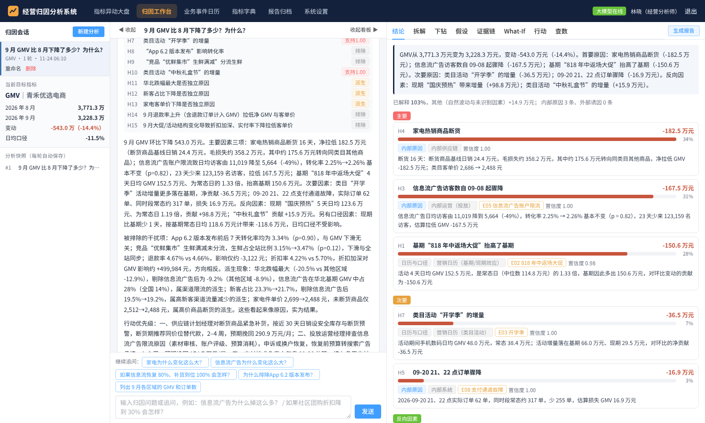
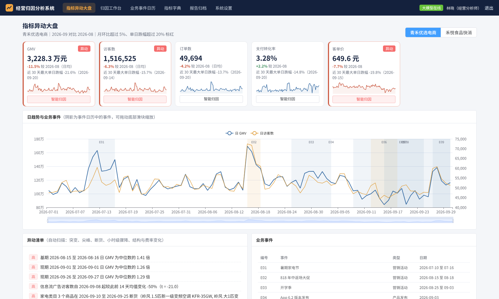
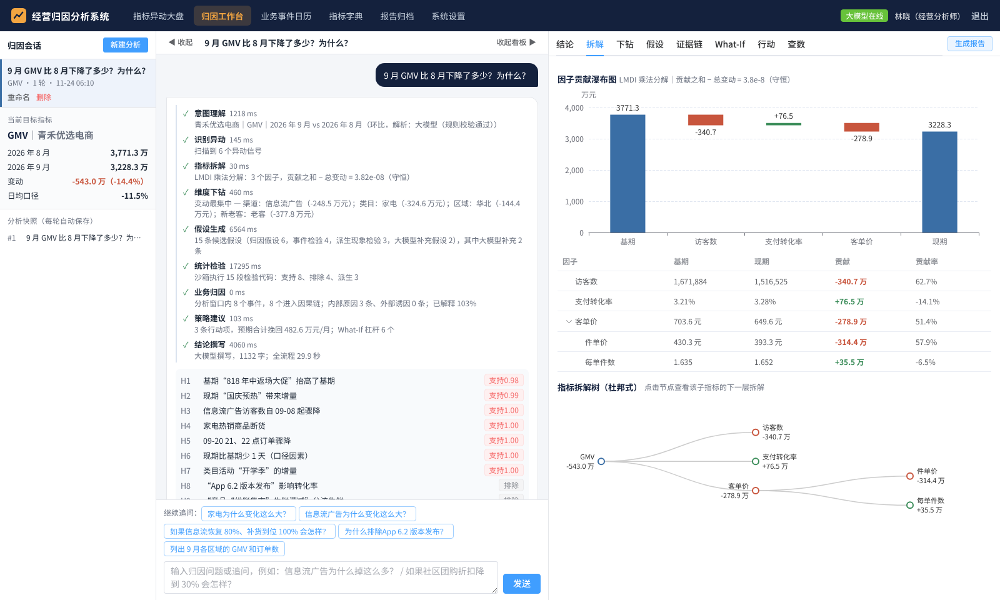
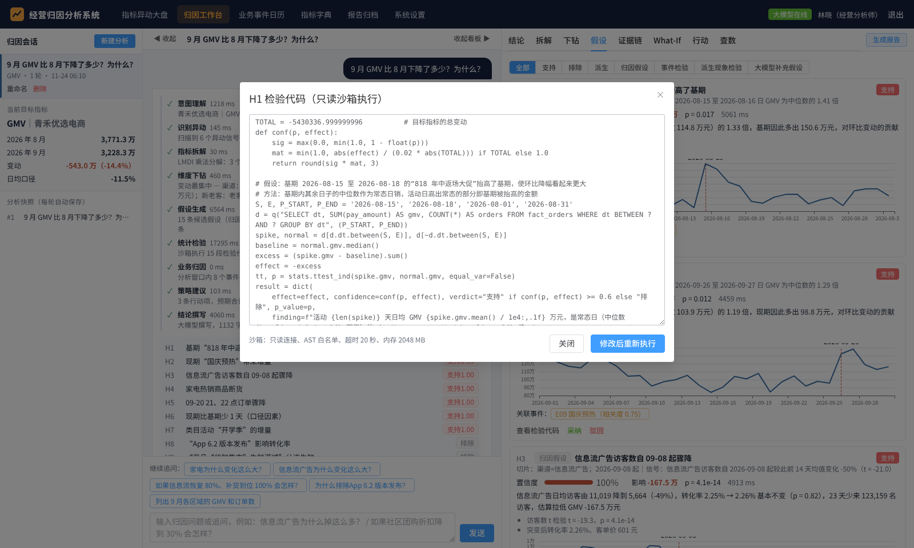
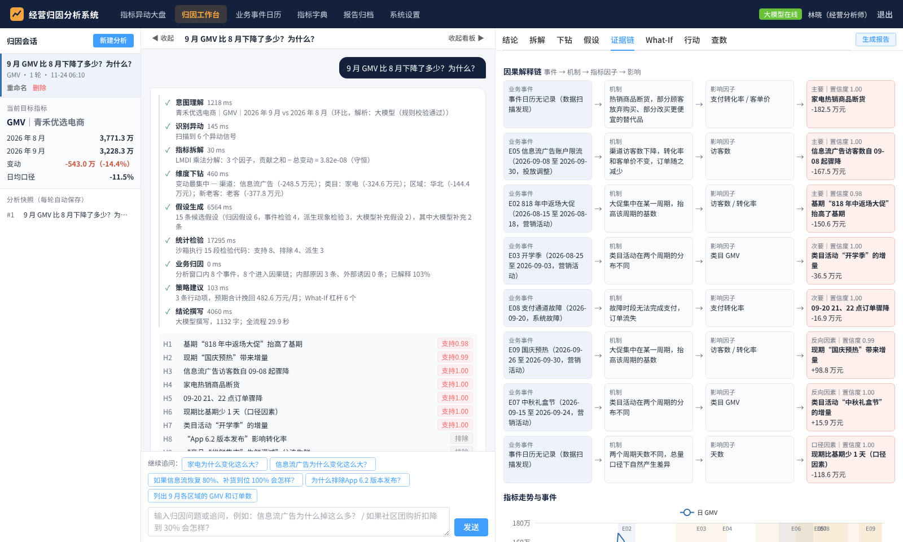
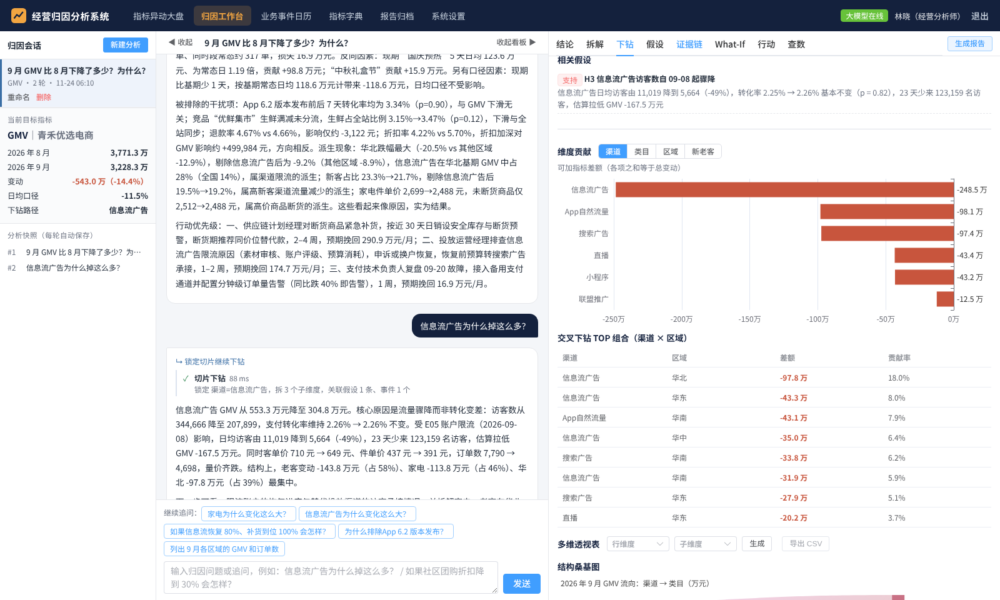
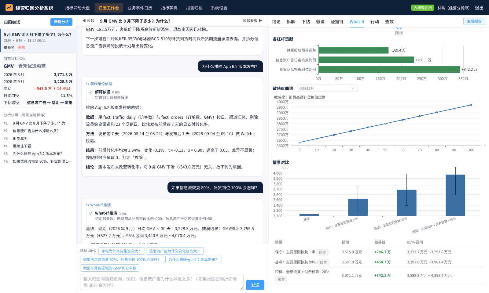
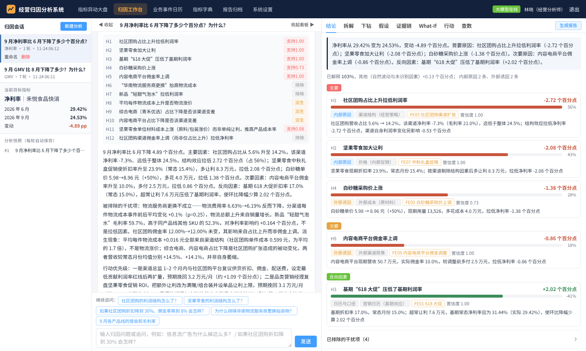
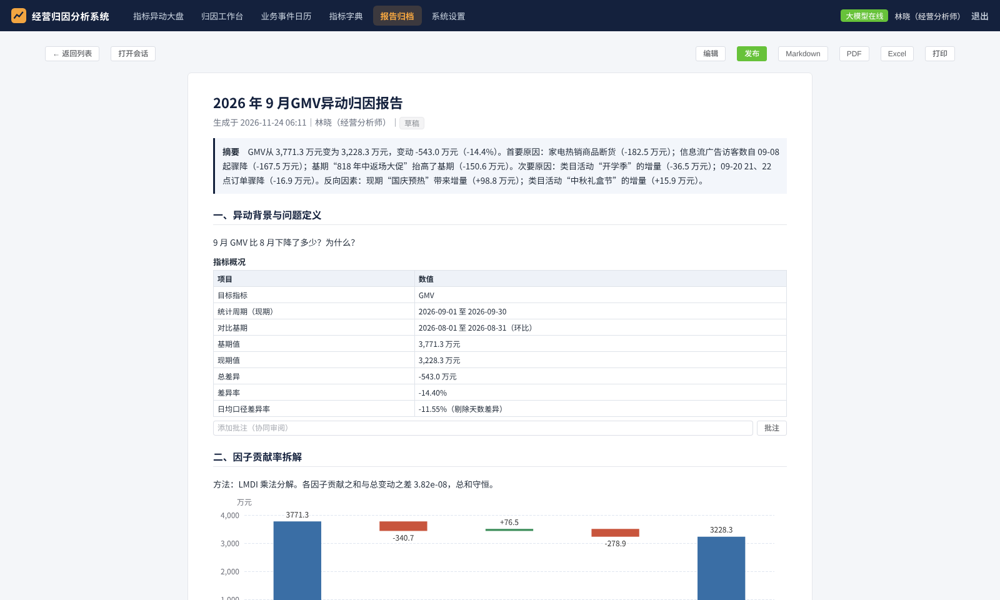
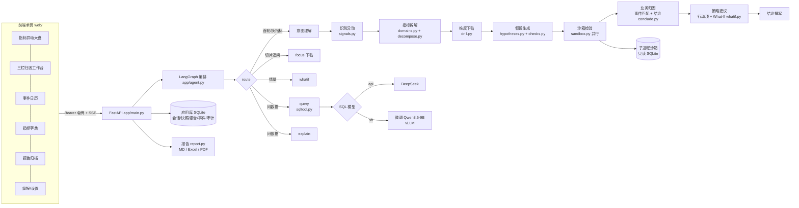

# Attribution-Agent

**经营指标智能归因 Agent**：一句话问“9 月 GMV 为什么掉了”，Agent 自动拆解指标、下钻维度、生成假设并在沙箱里用代码逐条检验、关联业务事件，给出带量化贡献、置信度和证据链的结论；之后可以继续追问、做 What-If 推演、直接问数据，最后一键导出报告。


> 仓库自带两套模拟数仓：电商 GMV（青禾优选）和快消利润率（禾悦食品）。数据由 `数据/生成脚本/` 按固定随机种子生成，埋入了已知原因、干扰项和派生现象，**公司、商品、事件全部为虚构**。

```
问：9 月 GMV 比 8 月下降了多少？为什么？
 ├─ 识别异动   GMV 3,771.3 → 3,228.3 万元（−14.4%）；信息流访客 9/8 断崖、3 款热销家电断货、818 大促抬高基期、9/20 晚间订单骤降
 ├─ 指标拆解   GMV = 访客 × 转化率 × 客单价，LMDI 分解，各因子贡献之和与总变动的误差 7e-15
 ├─ 假设检验   13 条假设各生成一段 Python 检验代码，在只读沙箱里并行执行，输出影响量、p 值、置信度
 ├─ 事件关联   按时间窗口、事件类型、切片三重匹配事件日历；App 6.2 发版、竞品生鲜满减经检验排除
 ├─ 结论       主要原因：断货 −182.5 万、信息流限流 −167.5 万、818 基期 −150.6 万；次要：支付故障 −16.9 万……
 └─ 行动       补货并设安全库存（预期挽回 290.9 万元/月）、信息流账户申诉换户（174.7 万元/月）……
```

## 界面



<table>
  <tr>
    <td width="50%"><br><sub>异动大盘：按阈值标红指标，日趋势叠加事件阴影</sub></td>
    <td width="50%"><br><sub>因子贡献瀑布图与拆解树，点任一节点再拆一层</sub></td>
  </tr>
  <tr>
    <td><br><sub>每条假设的检验代码，可修改后在沙箱里重跑</sub></td>
    <td><br><sub>因果证据链：事件 → 机制 → 指标因子 → 影响</sub></td>
  </tr>
  <tr>
    <td><br><sub>多轮追问：信息流 → 华北 → 继续下钻，上下文跨轮保留</sub></td>
    <td><br><sub>What-If：滑块实时推演、敏感度曲线、情景对比</sub></td>
  </tr>
  <tr>
    <td><br><sub>快消场景：净利率下降 4.89 个百分点的四个原因与反向因素</sub></td>
    <td><br><sub>结构化报告：在线编辑、批注、发布，导出 PDF / Excel / Markdown</sub></td>
  </tr>
</table>

全部 39 张截图（覆盖每个页面和三种角色）见 [`截图/`](截图)，同目录下的 `报告导出.pdf / .xlsx / .md` 是从页面上导出的报告原件。

## 功能亮点

| 能力 | 做法 | 代码 |
| --- | --- | --- |
| **LangGraph 编排** | 分析主链 9 个节点（理解 → 异动 → 拆解 → 下钻 → 假设 → 检验 → 事件 → 建议 → 撰写）+ 追问 4 条分支（切片下钻、What-If、查数、解释依据）；每个节点通过 SSE 流式推送进度 | [`agent.py`](app/agent.py) |
| **指标拆解** | 乘法模型用 LMDI（各因子贡献严格守恒）、加法模型用差额分析、比率指标按维度下钻用结构 × 水平两因子 Shapley、成本率三步替换拆成结构 / 价格 / 单位成本 | [`decompose.py`](app/decompose.py) |
| **异动识别** | 突变点检验（逐日搜索使前后均值 t 值最大的切点）、日尖峰、小时级骤降、断货、渠道结构与费率变化；只看数据，不读答案 | [`signals.py`](app/signals.py) |
| **假设代码化 + 沙箱检验** | 22 个检验模板覆盖常见经营异动，大模型补充规则库外的假设并自己写检验代码（报错自动修一次）；代码在独立子进程执行：AST 白名单、只读连接、受限表拦截、超时与内存配额 | [`hypotheses.py`](app/hypotheses.py) · [`checks.py`](app/checks.py) · [`sandbox.py`](app/sandbox.py) |
| **业务事件关联** | 事件日历按时间窗口、类型相容、切片一致三重匹配；结论分主要 / 次要 / 反向 / 口径因素，区分内部原因与外部诱因，派生现象挂到所属原因下 | [`conclude.py`](app/conclude.py) |
| **What-If 推演** | 杠杆由归因结果自动生成（恢复比例、折扣、佣金、原料价、预算、价格弹性），95% 区间、各杠杆贡献、敏感度曲线、情景保存与对比；也能用自然语言描述情景 | [`whatif.py`](app/whatif.py) |
| **自然语言查数** | 通用大模型（DeepSeek）与自训的 Qwen3.5-9B SQL 模型（[Text2SQL-Qwen-SFT](https://github.com/habiball343/Text2SQL-Qwen-SFT)）一键切换，共用同一份提示词，执行报错回传修复 | [`sqltool.py`](app/sqltool.py) |
| **结构化报告** | 七章报告在线预览、编辑、批注、发布；PDF 嵌入中文字体并绘制瀑布图，Excel 含原生图表和检验代码附录 | [`report.py`](app/report.py) |
| **大模型护栏** | 大模型补充的假设默认不计入贡献、需分析师采纳；影响量超过总变动 2 倍直接排除；与已有原因重复时提示；结论里的数字全部取自检验结果 | [`agent.py`](app/agent.py) |
| **离线可运行** | 不配大模型密钥时，整条链路由规则引擎跑通（意图解析、假设、结论撰写都有规则版本） | — |

另有三角色权限（经营分析师 / 业务负责人 / 管理员）、事件日历维护、指标字典、归因简报订阅、操作审计和运行日志。

## 架构



### 分析主链

1. **意图理解**：规则解析指标、现期、基期（“9 月比 6 月”“环比”），在线时大模型再解析一遍、规则校验通过才采用；超出数据范围直接提示。
2. **识别异动**（`signals.py`）：渠道访客突变点、基期 / 现期日 GMV 尖峰、某天某小时订单骤降、断货商品、渠道营收占比变化、产品线折扣率上升、基期大促让利、原料价格变化、佣金率调整。
3. **指标拆解**（`decompose.py`）：乘法模型用 LMDI（对数平均权重，各因子贡献之和严格等于总变动）；加法模型用差额；比率指标按维度下钻用结构 × 水平两因子 Shapley（结构效应相对整体均值计算）；成本率按“先换结构、再换价格、最后换单位成本”三步替换拆成三份。
4. **维度下钻**：电商按渠道 / 类目 / 区域 / 新老客，外加渠道 × 区域交叉；快消按渠道 / 产品线；桑基图展示现期结构。
5. **假设生成**（`hypotheses.py`，22 个检验模板在 `checks.py`）三组：
   - 归因假设：每个异动信号一条（流量骤降、断货、基期/现期大促、小时级故障、渠道结构、促销让利、原料涨价、佣金上调、天数口径）
   - 事件检验：窗口内没有被信号认领的事件，检验它到底有没有影响（版本发布、竞品活动、类目活动、物流调整、新品上市）
   - 派生现象检验：下钻里最显眼的现象（跌幅最大的区域、新客占比下降、类目客单价下降等），检验它是不是其他原因的结果
   - 在线时大模型再补充最多 2 条，自己写检验代码；默认不计入贡献，分析师“采纳”后才计入
6. **沙箱检验**（`sandbox.py`）：6 路并行。每段代码最后赋值 `result = dict(effect, confidence, verdict, p_value, finding, evidence, series)`。置信度 = (1 − p) × min(1, |影响| ÷ 总变动的 2%)，低于 0.6 自动排除。
7. **业务归因**（`conclude.py`）：按影响占总变动比例分主要（≥ 20%）/ 次要（≥ 2%）/ 反向因素 / 口径因素；未解释部分记为“其他”；每条原因生成“事件 → 机制 → 指标因子 → 影响”的因果链。
8. **策略建议**：每条可干预的原因对应一条行动（责任岗位、动作、完成周期、预期挽回金额 = 影响折算到月 × 可挽回比例），同时生成 What-If 模型。

### 事件匹配规则

- 时间：阶跃型异动（流量突变、费率调整）要求事件开始日落在突变点前后 3 天内；区间型异动要求事件与 [开始 − 3 天, 结束 + 3 天] 重叠
- 类型：事件类型与假设类型相容（流量骤降 ↔ 投放调整 / 竞品动态 / 渠道政策，小时级骤降 ↔ 系统故障……）
- 切片：事件标了渠道 / 类目 / 产品线的，必须与假设切片一致；没标的视为全局事件
- 相关度 = 0.5 × 时间重合度 + 0.5 × 切片重合度

这几条规则来自调试：最初只按时间窗口匹配，竞品生鲜活动和支付故障都被挂到了信息流流量骤降上，生鲜的竞品检验就没有生成。

### 沙箱

- 静态检查：只允许导入 pandas / numpy / scipy.stats / math 等；禁止 open、exec、eval、getattr 等内置函数和双下划线属性；禁止 pandas / numpy 的文件读写接口
- 数据只能通过注入的 `q(sql, params)` 读取：只读连接、单条 SELECT、拦截受限表 `dim_user`（含姓名手机号）
- 独立子进程（`python -I`），超时强制结束；Linux / macOS 上再限制内存和 CPU 时间；数值库线程数固定为 1（多核云主机上 OpenBLAS 按核数预分配线程缓冲，会在内存配额下卡死，部署到 128 核实例时踩到过）
- 分析师可以在假设卡片里打开代码、修改后重新执行，同样走这一套检查

## 评测

### 归因准确性（`python eval/eval_attribution.py`）

数据生成时用反事实方法算出了每个埋入原因的真实影响，写在 `数据/标准答案_*.json`。**这些文件只有评测脚本读，`app/` 下没有任何代码引用它们**。离线规则模式结果：

| 指标 | 电商 GMV 下滑 | 快消利润率异动 |
| --- | --- | --- |
| 拆解守恒（相对误差） | 7.0e-15 | 2.8e-16 |
| 与参考分解的逐因子误差 | 0.000 万元 | 0.000 pp |
| 根因命中率 | 4/4 | 5/5 |
| 主要 / 次要 / 反向判定一致 | 4/4 | 5/5 |
| 影响估计平均相对误差 | 12% | 11% |
| 事件关联正确 | 3/3 | 5/5 |
| 干扰项排除 | 2/2 | 2/2 |
| 派生现象识别并归到正确原因 | 3/3 | 2/2 |
| 误报的主要原因 | 0 | 0 |
| 全流程耗时 | 约 10 秒 | 约 7 秒 |

逐条对比：

| 场景 | 根因 | 真实影响 | Agent 估计 | 误差 |
| --- | --- | --- | --- | --- |
| 电商 | 信息流广告账户限流（主要） | −196.0 万元 | −167.5 万元 | 14% |
| 电商 | 三款热销家电断货（主要） | −214.2 万元 | −182.5 万元 | 15% |
| 电商 | 818 大促抬高基期（主要） | −127.6 万元 | −150.6 万元 | 18% |
| 电商 | 9/20 支付通道故障（次要） | −17.2 万元 | −16.9 万元 | 2% |
| 快消 | 社区团购渠道扩张（主要） | −3.01 pp | −2.72 pp | 10% |
| 快消 | 中秋促销让利（主要） | −1.50 pp | −2.08 pp | 38% |
| 快消 | 白砂糖涨价（主要） | −1.39 pp | −1.38 pp | 0% |
| 快消 | 内容电商佣金上调（次要） | −0.86 pp | −0.86 pp | 0% |
| 快消 | 618 压低基期（反向） | +2.20 pp | +2.02 pp | 8% |

误差来源：

- 中秋让利偏高 38%：标准答案的反事实是“没有额外 12% 让利、但保留节日常规 2% 让利”，Agent 以非大促月份为常态，把常规让利也算进去了。数据里分不出这 2%，属于口径差异。
- 电商流量和断货低估约 15%：Agent 用“突变前 14 天均值”作对照，而这 14 天里有开学季活动的余温和部分自然下滑；断货只计算了净流失（转买替代品的部分已扣除）。
- 标准答案把“少 1 天、开学季落在 8 月、国庆预热增量”合并为“其他 +12.0 万元”；Agent 把它们拆成口径因素（−118.6）、次要原因（开学季 −36.5）和反向因素（国庆预热 +98.8、中秋礼盒节 +15.9），剩余未解释 +14.9 万元。

### 接入大模型后（`python eval/eval_attribution.py --online`，deepseek-flash 关闭思考）

准确性指标与离线完全一致（根因 9/9、主次 9/9、干扰项 4/4、派生 5/5，平均误差约 12%），因为量化结论都来自沙箱检验，大模型不改数字。大模型多做了四件事：

| 环节 | 实测 |
| --- | --- |
| 意图解析 | 两个问题都由大模型解析、规则校验通过后采用，约 1.1 秒 |
| 补充假设 | 每个场景补 2 条（如“退款率上升”“加购率恶化”“坚果零食单位成本上涨”“社区团购费率恶化”），全部写出可执行的检验代码；1 条首次执行报错，把报错交回模型后修好；4 条检验结果都是“排除”，没有被误采信 |
| 结论撰写 | 流式输出约 1000 字，数字全部取自检验结果 |
| 耗时与用量 | 电商 26 秒、快消 29 秒；两个场景合计 7 次调用，输入 7.6 千、输出 6.4 千 Token |

调试中给大模型补充的假设加了三道护栏：默认不计入贡献，分析师“采纳”后才进结论；影响量超过总变动 2 倍的直接判为排除（实测出现过一次：模型把百分点当成小数，算出 −108 个百分点）；和已支持的原因说的是同一件事时（如“社区团购折扣率上升”和“社区团购占比上升”）提示可能重复。

### 端到端测试（`python eval/acceptance_test.py [--online]`）

在临时库里用 HTTP 接口把 8 个核心场景逐条走一遍：发起归因、拆解守恒、假设检验与排除干扰、多轮下钻追问、事件关联、What-If、报告导出、电商与快消双场景闭环；另检查三种角色的权限拦截（业务负责人不能建会话、分析师不能改事件日历和看审计）。离线、在线均 8/8 通过，结果在 `eval/结果/`。

### 自然语言查数：通用大模型 vs 自训 SQL 模型（`python eval/compare_sql_models.py --mode api|sft`）

查数工具可切换到 [Text2SQL-Qwen-SFT](https://github.com/habiball343/Text2SQL-Qwen-SFT) 里 QLoRA 微调的 Qwen3.5-9B。用 vLLM 部署后在 `.env` 填 `SQL_LLM_BASE_URL=http://<地址>:8000/v1`，再到“系统设置”或工作台查数页切换。两种模型用同一份提示词（`app/sql_prompt.py`，与训练数据一致），执行报错时把报错带回去让模型修一次。

10 道归因分析中常问的数据问题（电商 6 道、快消 4 道，见 `eval/sql_questions.jsonl`），人工写标准 SQL，按执行结果比对（忽略行序列序）。微调模型部署在单张 RTX 4090 上，走同一个查数工具：

| 问题 | DeepSeek（deepseek-flash） | 微调 Qwen3.5-9B |
| --- | --- | --- |
| 9 月各渠道的 GMV 和订单数 | ✓ | ✓ |
| 列出 9 月各区域的 GMV 和订单数 | ✓ | ✓ |
| 9 月信息流广告每天的访客数 | ✓ | ✓ |
| 9 月家电类目 GMV 最高的 5 个商品 | ✓ | ✓ |
| 8 月和 9 月的支付转化率分别是多少 | ✗ | ✗ |
| 9 月新客订单占比是多少 | ✓ | ✓ |
| 9 月各渠道的营收和佣金分别是多少 | ✗ | ✓ |
| 9 月各产品线的营收和毛利率 | ✓ | ✗ |
| 6 月到 9 月每个月的净利率 | ✓ | ✗ |
| 9 月社区团购渠道的折扣率 | ✓ | ✓ |
| 合计 | 8/10 | 7/10 |

- 两个模型都错的“支付转化率”：DeepSeek 把订单按天连到访客表再按月汇总，访客数被每笔订单重复计算；微调模型把分子分母写反，还输出成了一行两列。
- 只有 DeepSeek 错的“各渠道营收和佣金”：月度佣金表连到日销售明细，佣金放大 711 倍（正好是该渠道当月的明细行数）；微调模型直接用月度佣金表，答对。
- 只有微调模型错的“产品线毛利率”“每月净利率”：要按销售月份关联成本表、再汇总四张费用表，模型把字段写到了不存在它的表上，带着报错修正一次后仍然失败。这和微调项目测试集上的结论一致：训练里没见过的多表写法泛化不了。
- 结论：日常查数默认用 DeepSeek；数据不能出内网、问题以单表和常见连接为主时，可以切到本地微调模型。界面见 `截图/38_切换到微调SQL模型.png`、`截图/39_微调模型查数.png`。

## 快速开始

```bash
pip install -r requirements.txt
cp .env.example .env             # 可选：填 LLM_API_KEY（DeepSeek）；不填就是离线规则模式
python scripts/fetch_vendor.py   # 可选：把前端依赖下载到本地，不下载会自动走 CDN
python scripts/start.py          # Windows 也可以双击 run.bat
```

浏览器打开 http://127.0.0.1:8001 。数仓文件在 `数据/` 下（ecommerce.db、fmcg.db），首次启动自动创建账号和指标字典。

| 账号 / 密码 | 角色 | 能做什么 |
| --- | --- | --- |
| analyst / analyst123 | 经营分析师 | 发起归因、追问、审核证据链（采纳 / 驳回 / 改代码重跑）、What-If、生成 / 编辑 / 发布 / 导出报告 |
| manager / manager123 | 业务负责人 / 管理层 | 看大盘、看已发布报告和行动项、订阅归因简报、导出 |
| admin / admin123 | 系统与数据管理员 | 维护事件日历和指标字典、切换 SQL 模型、调阈值与沙箱配额、看审计与运行日志 |

### 演示路线

1. 用 analyst 登录，大盘上 GMV 卡片标红，点“智能归因”。看中栏九个步骤流式完成、假设逐条出结果，右栏结论卡片、瀑布图、拆解树。
2. 追问“信息流广告为什么掉这么多？”→“那华北呢”→“继续往下看”，右栏下钻页刷新，左栏下钻路径和快照更新。
3. 追问“为什么排除 App 发版？”，假设页筛出相关假设，展开检验代码看判断依据。
4. 在 What-If 页拖“信息流访客恢复比例”“断货补货到位比例”，看预测值、区间、敏感度曲线；点预置情景、保存情景对比。
5. 追问“列出 9 月各区域的 GMV 和订单数”，查数页给出 SQL 和结果。
6. 点“生成报告”，加批注、发布、导出 PDF / Excel / Markdown；用 manager 登录看简报和已发布报告。
7. 切到快消：“9 月净利率比 6 月下降了多少个百分点？为什么？”，看渠道结构、促销、原料、佣金四个原因和 618 基期反向因素，以及物流服务商更换、新品上市两个干扰项被排除。
8. 用 admin 登录补录一个事件（例如 9/7 信息流素材审核收紧），回到工作台重新分析，信息流假设会关联到它。

## 目录

```
app/
  main.py            HTTP 接口（会话、SSE 分析、审核、What-If、透视、报告、事件、指标、简报、设置、审计）
  agent.py           LangGraph 编排：主链 9 个节点 + 追问 4 个分支，流式事件
  domains.py         两个指标域：指标定义、拆解树、拆解与下钻、意图解析
  decompose.py       LMDI、差额、结构 × 水平 Shapley、守恒校验
  signals.py         异动扫描
  hypotheses.py      假设生成与事件匹配
  checks.py          22 个检验代码模板（沙箱里执行）
  sandbox.py / sandbox_runner.py  沙箱
  conclude.py        结论分级、因果链、派生归属、行动项
  whatif.py          What-If 模型、情景、区间、敏感度
  drill.py           切片下钻、透视表、桑基图
  dashboard.py       异动大盘
  sqltool.py / sql_prompt.py  自然语言查数（通用模型 / 微调模型）
  report.py          报告组装与 MD / Excel / PDF 导出
  llm.py / db.py / auth.py / config.py / warehouse.py
web/                 index.html、app.js、style.css（无构建步骤；vendor/ 由 fetch_vendor.py 下载）
eval/                eval_attribution.py、acceptance_test.py、compare_sql_models.py、结果/
数据/                ecommerce.db、fmcg.db、数据说明.md、生成脚本/、标准答案（仅评测用）
截图/                39 张界面截图与导出的报告样例
scripts/             start.py、fetch_vendor.py
```

## 主要配置（`.env`）

| 变量 | 默认 | 说明 |
| --- | --- | --- |
| LLM_BASE_URL / LLM_API_KEY / LLM_MODEL | DeepSeek / 空 / deepseek-flash | 分析大模型；不填密钥为离线规则模式 |
| LLM_EXTRA_BODY | DeepSeek 时默认 `{"thinking": {"type": "disabled"}}` | deepseek-flash 默认开思考，思考内容占 max_tokens，短的 JSON 调用会被截空，所以默认关闭 |
| SQL_LLM_BASE_URL / SQL_LLM_MODEL | 空 / sft | 微调 SQL 模型的 vLLM 地址 |
| CONFIDENCE_THRESHOLD | 0.6 | 低于它的假设自动排除（管理员可在设置页改） |
| MAJOR_SHARE / MINOR_SHARE | 0.2 / 0.02 | 主要 / 次要原因的影响占比门槛 |
| EVENT_WINDOW_DAYS | 3 | 事件匹配窗口 |
| SANDBOX_TIMEOUT / SANDBOX_MEMORY_MB | 20 / 2048 | 沙箱配额 |
| WAREHOUSE_DIR / APP_DATA_DIR | 数据 / data | 数仓目录、应用数据目录 |
| PDF_FONT | 自动 | PDF 嵌入的中文字体（默认找 simhei / msyh / simsun / 文泉驿） |

## 局限与后续

- 检验模板覆盖的是常见经营异动（流量、断货、大促、故障、结构、价格、成本、费率）。新类型的异动靠大模型补充假设，默认不计入贡献，需要分析师审核采纳。
- 各原因的影响分别按反事实估计，合计不保证等于总变动（交互效应和未识别因素进“其他”）；拆解层（LMDI / 差额）是严格守恒的。
- What-If 用弹性系数和现期结构做线性外推，适合“恢复多少能挽回多少”这类近端推演，不适合大幅改价或渠道重构的长期预测。
- 简报订阅只记录订阅关系，页面上按需生成；定时推送（邮件 / IM）需要接入消息通道。
- 存储用 SQLite，适合单团队演示；多人并发和大数据量建议换 PostgreSQL / ClickHouse，数仓访问层（`warehouse.py`）只需替换连接。

## 相关项目

- [Text2SQL-Qwen-SFT](https://github.com/habiball343/Text2SQL-Qwen-SFT)：为本项目查数工具训练的 SQL 生成模型（Qwen3.5-9B QLoRA），两个数仓也是它的训练和评测数据来源
- [ServiceKB-RAG](https://github.com/habiball343/ServiceKB-RAG)：同一家模拟电商公司的客服知识库，权限感知的 RAG 问答平台
- [DataPulse-Agent](https://github.com/habiball343/DataPulse-Agent)：基于 MCP 协议的智能问数与报表分析助手

## License

[MIT](LICENSE)
